# STEP 2：项目架构和调用链分析

> 分析日期：2026-08-19  
> 分析基础：`docs/archive/01_PROJECT_AUDIT.md` 以及当前项目源码。  
> 本文关注“用户操作后，代码内部真实发生了什么”，不按目录逐文件复述。对于界面表达与真实调用不一致的地方，以实际传参、状态赋值和渲染条件为准。

## 架构总览

这个项目的运行方式可以概括为：

> **Router 驱动页面切换，页面组件直接承载大部分业务逻辑，薄 API 模块负责调用两个后端，组件本地响应式状态负责大部分界面更新，Vuex 主要服务于模型训练的跨步骤状态。**

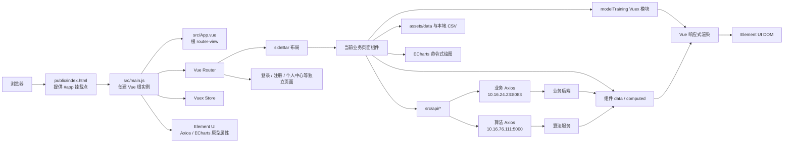

这里没有独立的 domain/service 业务层，也没有统一的 hooks/composables 层。典型调用是：

```text
模板事件 → 页面 methods → src/api 中的薄函数 → Axios → 后端
                                      ↓
模板重渲染 ← 修改组件 data / Vuex ← 返回已经解包的响应体
```

主要证据：`src/main.js`、`src/App.vue`、`src/router/index.js`、`src/store/index.js`、`src/utils/`、`src/api/`。

---

## 1. 应用启动流程

### 1.1 从 HTML 到 Vue 根实例

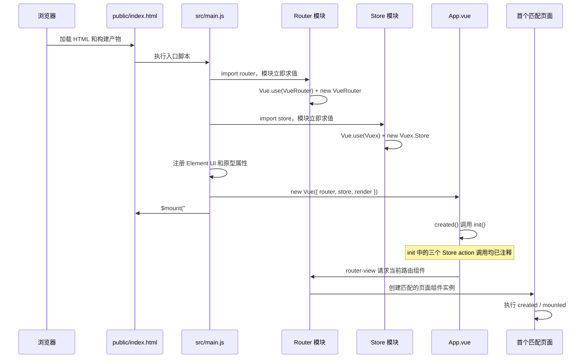

对应源码：

- HTML 挂载点：`public/index.html` 中的 `<div id="app"></div>`。
- 入口导入与根实例：`src/main.js:1-19`。
- 根组件路由出口：`src/App.vue:7`。
- 根组件初始化：`src/App.vue:20-31`。

### 1.2 首次打开根地址时实际发生什么

当前没有登录守卫。浏览器首次匹配 `/` 时：

1. Router 根据 `src/router/index.js:61-65` 匹配根路由；
2. 执行 `redirect: "/dash"`；
3. 创建 `sideBar` 布局组件；
4. 在 `sideBar` 自己的 `<router-view>` 中创建 `dash`；
5. `dash.created()` 同时启动首页统计请求。

因此，当前代码的默认入口不是 `/login`，而是直接进入 `/dash`。未登录时前端也会尝试加载首页并请求统计接口；能否拿到数据取决于后端，而不是前端路由控制。

证据：`src/router/index.js:61-70,133-155`、`src/views/dash/index.vue:128-147`。

## 2. 入口文件初始化流程

`src/main.js` 的职责很薄，顺序如下：

1. 导入 Vue、根组件、Router、Store；
2. 导入 Element UI、ECharts、Axios 和 Element UI 样式；
3. 写入 `Vue.prototype.$echarts` 和 `Vue.prototype.$axios`；
4. 关闭生产提示；
5. `Vue.use(ElementUI)`；
6. 创建根 Vue 实例并注入 `router`、`store`；
7. 通过 render function 渲染 `App`；
8. 挂载到 `#app`。

```js
new Vue({
  router,
  store,
  render: (h) => h(App),
}).$mount("#app");
```

关键事实：

- 没有启动前的用户会话恢复或 token 校验；
- 没有在入口统一加载字典、用户信息或权限；
- 没有全局业务组件注册；
- `App.created()` 虽映射了 `getDataList/getTaskList/getModelList`，但实际 dispatch 全部被注释，所以启动阶段不会预加载 Vuex 根列表；见 `src/App.vue:20-31`。
- 生产构建已证明 `import echarts from "echarts"` 对 ECharts 5 会产生“没有 default export”的警告；实际图表组件大多自行 `import * as echarts`，不依赖这个全局属性。

## 3. Router 初始化

### 3.1 初始化时机

`src/main.js` 导入 `router` 时，`src/router/index.js` 会立即执行：

1. 静态导入所有路由组件；
2. `Vue.use(VueRouter)` 安装插件；
3. 创建 `routes` 数组；
4. `new VueRouter({ routes })`；
5. 导出实例给根 Vue。

因为所有页面都是静态 import，没有使用 `() => import(...)`，路由切换不会再动态下载页面模块；这些页面会进入初始构建依赖图，但只有匹配页面才会创建 Vue 组件实例并执行生命周期。

### 3.2 路由层级

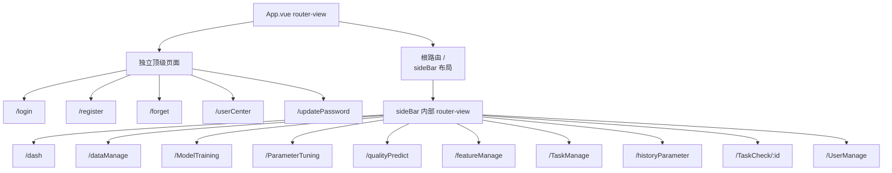

主布局的路由出口位于 `src/components/sideBar/index.vue:160`。侧栏 Element UI 菜单设置了 `router` 属性，点击 `index="/dataManage"` 等菜单项时，Element UI 内部调用 Router 导航；见 `sideBar/index.vue:48-127`。

### 3.3 导航后的布局行为

- `sideBar.data().activeMenu` 初始读取 `this.$route.path`；
- `$route` watcher 在每次子路由变化后同步 `activeMenu`；
- 侧栏本身保持挂载，内部业务页面被替换；
- 没有启用 `keep-alive`，旧页面组件会销毁，新页面重新执行 `created/mounted`；
- `AppMain.vue` 中的 transition/keep-alive 方案未被当前布局使用。

证据：`src/components/sideBar/index.vue:179-217`、`src/components/AppMain.vue`。

## 4. Store 初始化

### 4.1 Store 创建

导入 `src/store/index.js` 时执行：

1. `Vue.use(Vuex)`；
2. 导入 `taskModule`；
3. `new Vuex.Store(...)`；
4. 创建根 state/getters/actions/mutations；
5. 把 `taskModule` 注册为 `modelTraining` 命名空间模块。

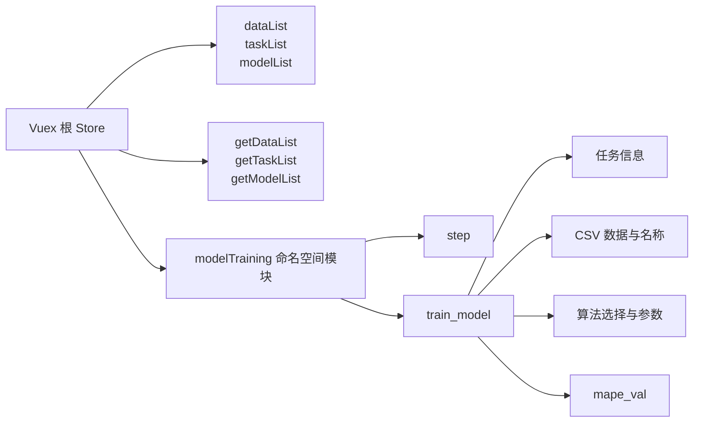

### 4.2 根 Store 和训练 Store 的实际使用差异

- 根 Store 的三个列表 action 当前没有从应用启动或当前登录页 dispatch，属于已定义但未形成当前主流程的数据源；见 `src/store/index.js:61-92`、`src/App.vue:25-31`。
- `modelTraining` 模块被训练向导真实使用；`ModelTraining.vue` 通过 `mapState("modelTraining", ["step"])` 订阅步骤；见 `ModelTraining.vue:42,58`。
- 五个步骤通过 `vuex_mixin.js` 调用 `this.$store.commit("modelTraining/...")`；见 `src/components/mixins/vuex_mixin.js:102-145`。

Store 中没有异步 action 处理训练逻辑；算法请求仍由页面组件直接发起，成功后才 commit 结果。

## 5. 全局组件 / 插件初始化

### 5.1 实际全局安装

| 全局能力 | 初始化位置 | 组件中的使用方式 |
| --- | --- | --- |
| Vue Router | `src/router/index.js:27` | `$router`、`$route`、`router-view`、菜单 router 模式 |
| Vuex | `src/store/index.js:6` | `$store`、`mapState`、`mapActions`、`mapMutations` |
| Element UI | `src/main.js:14` | `<el-*>`、`this.$message`、`this.$notify`、`this.$loading` |
| Axios 原型属性 | `src/main.js:11` | `this.$axios`，当前主要由未挂载的旧管理页使用 |
| ECharts 原型属性 | `src/main.js:10` | 当前可达图表组件基本不使用，改为组件内 namespace import |

没有 `Vue.component(...)` 注册的全局业务组件。`Params`、`DebouncedSelect`、`LineChart`、`Bar` 等都由使用它们的页面局部 import 和注册。

### 5.2 插件初始化与业务初始化的边界

Element UI、Router 和 Vuex 在根实例创建前就可用；但是业务数据没有在全局初始化。页面所需数据由每个页面自己的 `created()` 发请求。这造成的实际生命周期是：

```text
进入页面 → 先以 data() 默认值渲染 → created() 发请求
→ Promise 返回 → 给 data 属性赋值 → 页面局部更新
```

## 6. 页面加载过程

一个典型的主框架页面加载过程如下：

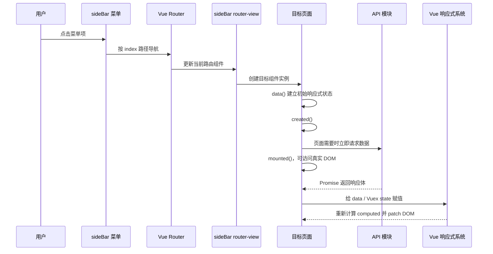

`created()` 适合发请求，因为此时响应式状态已建立；`mounted()` 被项目用于 ECharts 初始化，因为 ECharts 需要真实 DOM 容器。两者在项目中的典型例子：

- `dash.created()` 发统计请求：`src/views/dash/index.vue:128-147`；
- `FeatureSelect.mounted()` 初始化图表：`FeatureSelect.vue:125-143`；
- `LineChart.mounted()` 在父组件 `v-if` 成立后初始化 ECharts：`LineChart.vue:24-30`。

---

## 7. 用户操作如何触发组件逻辑

项目主要使用 Vue 模板事件绑定：

| 用户动作 | 模板写法 | 触发结果 | 示例 |
| --- | --- | --- | --- |
| 点击 | `@click="method"` | 调用当前组件 method | 登录、预测、导出、下一步 |
| 选择变化 | `@change="method"` | 选择值已由 v-model 更新，再调用 method | 数据类别、模型、机台 |
| 失焦 | `@blur="method"` | 执行查重或范围校验 | 训练任务名、参数比例 |
| 表单提交前校验 | `$refs.form.validate(...)` | Element UI 根据 rules 回调 valid | 登录、注册、找回密码 |
| 文件变化 | `el-upload :on-change` | 收到 Element UI file 对象 | CSV 上传 |
| 子组件事件 | `@submitParams="handler"` | 接收子组件 `$emit` 的数据 | `Params` → 参数调优/质量预测 |
| 路由菜单 | `el-menu router` | 根据 menu-item index 导航 | 主侧栏 |

用户事件不是通过统一 command/action 层分发，而是直接进入当前页面的 `methods`。

## 8. 组件如何调用业务逻辑

页面方法同时承担了多种职责：

- 表单校验；
- 参数格式转换；
- loading/message 控制；
- API 调用；
- 返回值解析；
- 本地状态更新；
- 页面跳转。

例如 `ParameterTuning.navigateToModelTraining()` 在一个方法里完成输入检查、打开 loading、拆分模型字符串、请求算法服务、解析 JSON 字符串、修改多个状态、关闭 loading 和显示结果；见 `src/views/ParameterTuning.vue:704-736`。

项目所谓“业务逻辑层”主要有两类薄封装：

1. `src/api/*.js`：把 URL 和 HTTP method 封装成函数；
2. `src/components/mixins/*.js`：复用表单 reset/debounce，以及把 Vuex commit 包装为 `m_*` 方法。

它们不负责复杂业务规则；规则仍留在页面组件内。

## 9. 业务逻辑如何调用 Store 或 API

页面逻辑有两条主要分支。

### 9.1 Store 分支

```text
页面 method
→ vuex_mixin 的 m_changeXxx
→ this.$store.commit("modelTraining/Mutation")
→ taskModule mutation 修改 state
→ 订阅该 state 的 computed 重新求值
→ 模板重渲染
```

典型例子是训练步骤切换：

- `TaskInfo.next()` 调 `m_changeStep(2)`；
- mixin commit `modelTraining/ChangeStep`；
- mutation 更新 `state.step`；
- `ModelTraining.vue` 的 `mapState` 得到新值；
- `v-if="step == 2"` 销毁 TaskInfo 并创建 DataSelect。

证据：`TaskInfo.vue:149-202`、`vuex_mixin.js:102-103`、`taskModule.js:70-72`、`ModelTraining.vue:18-35,58`。

### 9.2 API 分支

```text
页面 method
→ src/api 中的命名函数或通用 getRequest/postRequest
→ Axios 实例
→ 请求拦截器
→ HTTP 服务
→ 响应拦截器
→ 页面 await / then
→ 修改 data 或 commit Store
```

项目没有把所有请求统一到 Vuex action。首页、用户、数据管理、预测和调优都由组件直接调用 API。

## 10. API 数据如何返回

### 10.1 业务 API 返回链

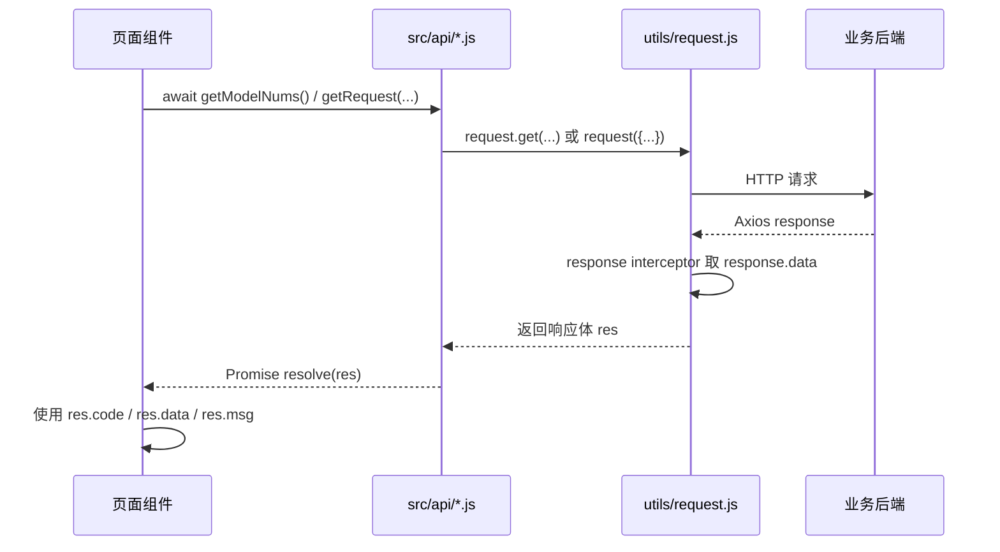

`utils/request.js:30-40` 会把 Axios response 解包成 `response.data`。因此页面拿到的 `res` 已经不是完整 Axios response，`res.data` 是业务响应体内部的 data。

### 10.2 算法 API 返回链

`utils/requestAlg.js:28-38` 同样返回 `response.data`，但算法页面期待的是更直接的字段：

- 参数推荐：`res.recommend_data`、`res.recommend_label`、`res.loss`；
- 训练：`res.mape_val`、`res.shap_importances`；
- 质量预测：当前代码把整个 `res` 当 JSON 字符串解析。

这说明两个服务的返回协议并不统一，页面承担了各自的解析逻辑。

### 10.3 旧用户请求封装

`src/utils/api.js` 修改全局 Axios 的 `baseURL`，并用响应拦截器返回 `success.data`。登录、注册、个人中心和用户管理使用这一套。它还可能根据 `success.data.message` 自动弹成功提示；业务页面随后又可能自行提示。

三套请求路径都没有当前生效的 Authorization 注入。

## 11. 数据如何进入响应式状态

### 11.1 组件本地状态

Vue 2 在组件创建时观察 `data()` 返回的属性。接口返回后执行：

```js
this.tableData = translatedData;
this.isShow = true;
```

会触发依赖这些属性的 render watcher。例子见 `src/views/dataManage.vue:98-102`。

数组整体替换、`push`、已有对象属性修改会被当前代码大量使用：

- `this.taskList = res.data`；
- `this.Bar_data.push(...)`；
- `row[key] = parseInput(val)`；
- `this.predictData = rawData`。

### 11.2 Computed 派生状态

`dataManage.pagedData` 依赖 `tableData/currentPage/pageSize`。其中任一变化都会让 computed 缓存失效，下次渲染重新 `slice`；见 `dataManage.vue:64-68`。

模型管理的筛选、分页和排序也采用 computed，从 `taskList` 与筛选输入派生 `displayedTasks`。

### 11.3 Vuex 状态

Vuex mutation 同步修改 `modelTraining.step` 或 `train_model`，通过 `mapState` 和 mixin computed 进入组件。Vuex 本身没有持久化插件，刷新页面后回到模块默认状态。

### 11.4 非响应式或命令式状态

- `sessionStorage` 本身不是响应式数据源；写入它不会自动通知 Vue。项目通常通过路由跳转/组件重建重新读取。
- ECharts 实例和 Canvas 不属于 Vue 虚拟 DOM。组件通常只在 `mounted()` 调一次 `setOption`，没有 watch props；后续 prop 原地变化不会自动让图表刷新。
- 首页用 `v-if="LineChartVue_x.length && LineChartVue_y.length"` 等条件，确保请求数据到达后才第一次创建图表组件，从而规避首次空数据问题；见 `dash/index.vue:56-67`。

## 12. 页面如何重新渲染

Vue 2 的重新渲染不是重新加载整页，而是：

1. setter 捕获响应式状态变化；
2. 依赖该状态的 watcher 被放入异步更新队列；
3. computed 在需要时重新求值；
4. render 生成新的虚拟 DOM；
5. Vue 对比并 patch 必要的真实 DOM。

本项目中最典型的触发方式：

- `showResult = true`：之前不存在的结果区因 `v-if` 被创建；
- `tableData = res.data`：Element UI table 接收新数组并生成行列；
- `currentPage = page`：`pagedData` 重新切片；
- `modelTraining.step = 2`：整个训练步骤组件被替换；
- `loading = true/false`：Element UI loading 指令切换遮罩。

对于 ECharts，Vue 只负责创建 `<div>` 容器；真正的 Canvas/SVG 内容由 `echarts.init(...).setOption(...)` 命令式生成，不走 Vue 的虚拟 DOM diff。

## 13. 不同模块之间如何通信

| 通信方式 | 数据方向 | 实际例子 | 关键文件 |
| --- | --- | --- | --- |
| Props | 父 → 子 | 首页把 x/y 传给 LineChart；页面把参数对象传给 Params | `dash/index.vue`、`Params.vue` |
| 自定义事件 | 子 → 父 | Params `$emit('submitParams')` | `Params.vue:382-384` |
| Vue 2 `v-model` 协议 | 父 ↔ 子 | DebouncedSelect 的 `value` prop + `input` event | `DebouncedSelect.vue:29-54` |
| `$refs` | 父 → 子命令 | 父页面主动调用 `paramsComponent.emitParamsToParent()` | `ParameterTuning.vue`、`qualityPredict.vue` |
| Vuex | 训练步骤之间 | TaskInfo/DataSelect/AlgorithmSelect/Result 共享 `train_model` | `store/taskModule.js`、`vuex_mixin.js` |
| Router | 页面之间 | 登录跳 dashboard；模型卡片跳 TaskCheck | `Login.vue`、`TaskManage.vue` |
| 路由参数 | 列表 → 详情 | `/TaskCheck/:id` → `$route.params.id` | `TaskManage.vue`、`TaskCheck.vue` |
| sessionStorage | 跨页面会话 | username/userid/userrole/token | 登录、侧栏、用户管理、模型管理 |
| API/后端 | 非直接兄弟模块 | 保存模型后 TaskManage 重新从后端拉取 | `Result.vue`、`TaskManage.vue`、`api/model.js` |
| 静态模块 import | 构建期共享数据 | 字段映射、默认工艺参数、算法列表 | `assets/data/*` |

没有发现全局事件总线、provide/inject、消息队列或跨窗口通信。

---

# 二、五条核心真实业务流程

## 流程一：用户登录后进入首页

### 业务调用链

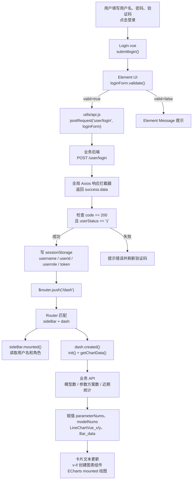

### 对应代码

| 步骤 | 文件与函数 |
| --- | --- |
| 表单与点击 | `src/components/tab/user/Login.vue:30-95` |
| 登录处理 | `Login.vue:217-248` 的 `submitlogin()` |
| 请求函数 | `src/utils/api.js:40-47` 的 `postRequest()` |
| 响应解包 | `src/utils/api.js:26-36` 的响应拦截器 |
| 保存身份 | `Login.vue:231-234` |
| 页面导航 | `Login.vue:236` |
| 布局匹配 | `src/router/index.js:61-70` |
| 侧栏读取会话 | `src/components/sideBar/index.vue:179-188` |
| 首页发起统计 | `src/views/dash/index.vue:128-147` |
| 图表延迟创建 | `dash/index.vue:56-67` |
| ECharts 绘制 | `src/components/tab/subcomponents/LineChart.vue`、`Bar.vue` |

### 状态与渲染细节

- `submitlogin()` 使用 Promise `.then`，登录成功前按钮 loading 被设置为 true；但模板的 el-form 没有绑定 `v-loading="loading"`，所以该状态不一定产生可见遮罩。
- Router 导航导致 Login 销毁，创建 sideBar 和 dash。
- `dash.created()` 不等待 `init()` 再执行 `getChartData()`；两组 async 函数会交错运行。每组内部请求仍按 `await` 顺序串行。
- 统计数字初始为 0，接口回来后直接修改本地 data，卡片文本局部更新。
- 图表组件受 `v-if` 控制，数据数组非空时才创建，`mounted()` 读取已经到位的 props 并绘制。

### 当前边界

- 登录后保存的 token 不会进入后续请求头。
- 未登录用户直接访问 `/dash` 时，Router 不会拦截。
- 侧栏管理员菜单只是依据 sessionStorage 隐藏/显示，不构成路由权限控制。

## 流程二：查看某类生产数据并导出 Excel

### 业务调用链

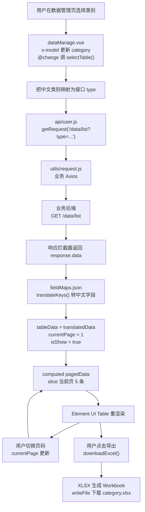

### 对应代码

| 步骤 | 文件与函数 |
| --- | --- |
| 类别选择 | `src/views/dataManage.vue:5-8` |
| 接口类型映射与请求 | `dataManage.vue:79-104` 的 `selectTable()` |
| 通用 GET | `src/api/user.js:8-17` |
| Axios 解包 | `src/utils/request.js:30-40` |
| 字段翻译 | `dataManage.vue:71-77`、`src/assets/data/fieldMaps.json` |
| 分页派生 | `dataManage.vue:64-68` 的 `pagedData` |
| 页码更新 | `dataManage.vue:117-119` |
| Excel 导出 | `dataManage.vue:120-133` |

### 状态与渲染细节

- 选择框 `v-model` 先更新 `category`，然后 `selectTable()` 才读取新值。
- `tableData` 整体替换触发表格列和行更新；列由 `tableData[0]` 的 key 动态生成。
- `pagedData` 不是独立存储，而是从完整 `tableData` 派生，因此页码变化不需要重新请求后端。
- 导出使用完整 `tableData`，不是 `pagedData`，所以会导出该类别所有已加载记录。
- 这一流程不经过 Vuex，页面离开后数据随组件销毁。

## 流程三：上传 CSV 并请求参数推荐，再保存历史方案

### 主调用链

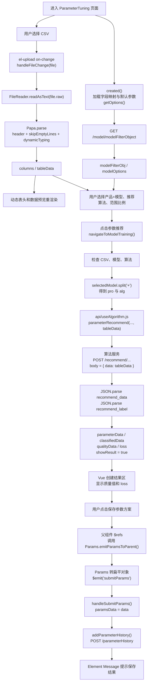

### 元数据下拉的子调用链

`DebouncedSelect` 体现了父子组件双向通信：

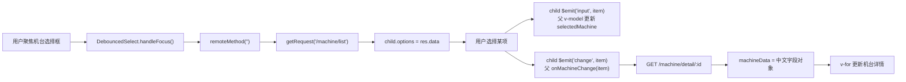

相同链路也用于模具、材料和产品。对应代码：`src/components/DebouncedSelect.vue:45-88`、`src/views/ParameterTuning.vue:658-697`。

### 关键文件与函数

| 环节 | 文件与函数 |
| --- | --- |
| 页面初始化 | `src/views/ParameterTuning.vue:573-580` |
| 模型选项 | `ParameterTuning.vue:648-659` 的 `getOptions/handleKeyChange` |
| CSV 读取 | `ParameterTuning.vue:748-779` |
| 点击推荐 | `ParameterTuning.vue:704-736` |
| 推荐 API | `src/api/useAlgorithm.js:3-7` |
| 算法 Axios | `src/utils/requestAlg.js` |
| 参数子组件输出 | `src/components/tab/Params.vue:319-384` |
| 父组件接收 | `ParameterTuning.vue:623-625` |
| 保存历史 | `ParameterTuning.vue:627-646`、`src/api/parameterHistory.js:3-5` |

### 当前真实数据流边界

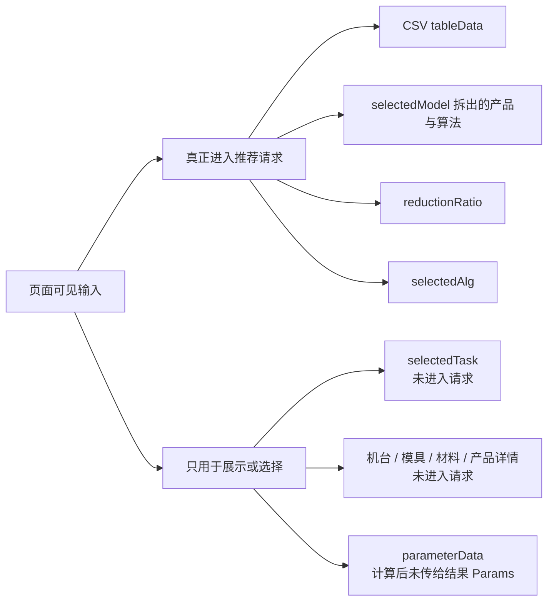

还需注意：

- 推荐结果虽然写入 `parameterData`，结果区 `<Params :params="params">` 仍绑定初始 `params`，所以 Vue 响应式更新的 `parameterData` 没有成为参数表的 prop。
- 保存历史时，`paramsJson` 来自 Params 组件，但机台 IP、模号、产品料号、物料代码为页面中的固定字符串。
- `showResult = true` 是真正触发结果区创建的状态开关；`qualityData` 和 `loss` 随之显示。

## 流程四：输入工艺参数并进行质量预测

### 业务调用链

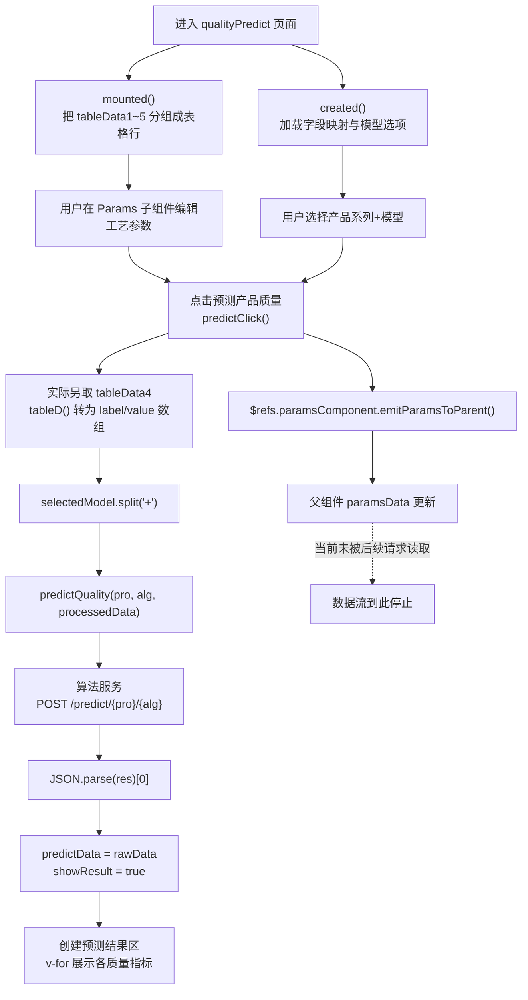

### 对应代码

| 环节 | 文件与函数 |
| --- | --- |
| 页面初始化 | `src/views/qualityPredict.vue:410-425` |
| 元数据列表/详情 | `qualityPredict.vue:485-535`、`DebouncedSelect.vue` |
| 参数组件内部编辑 | `src/components/tab/Params.vue:26-109` |
| 子组件扁平化与 emit | `Params.vue:319-384` |
| 父组件接收 | `qualityPredict.vue:482-484` |
| 预测方法 | `qualityPredict.vue:543-569` |
| 预测 API | `src/api/useAlgorithm.js:9-11` |
| 结果模板 | `qualityPredict.vue:141-164` |

### 响应式更新过程

1. Params 内每个输入框修改已观察的 row 对象属性；
2. 点击预测时 `$emit` 同步把扁平对象写到父组件 `paramsData`；
3. 当前代码没有继续使用 `paramsData`，而是使用 mounted 时转换好的 `tableData4`；
4. 算法返回后 `predictData` 整体替换；
5. `showResult` 从 false 变 true；
6. Vue 创建结果 form，并根据 `predictData` 的 key/value 生成网格。

### 当前真实输入范围

进入 `/predict` 请求的只有：

- `selectedModel` 拆出的产品系列 `pro`；
- `selectedModel` 拆出的算法 `alg`；
- `tableData4` 转出的硬编码工艺参数数组。

没有进入请求的可见输入包括：

- 用户刚刚在 Params 组件中编辑并输出的 `paramsData`；
- `selectedTask`；
- 机台、模具、材料、产品详情。

所以这里必须区分“界面收集到了数据”和“数据真正流入算法请求”。

## 流程五：创建模型训练任务并保存模型记录

### 跨步骤架构

训练流程与其他页面最大的不同，是它通过 Vuex 在五个互相销毁/创建的步骤组件之间保留状态。

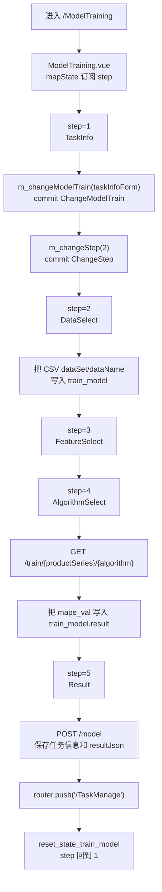

每次 `step` 变化都会让 `ModelTraining.vue` 的某个 `v-if` 成立，创建新步骤组件；上一步组件销毁，但表单内容保存在 Vuex `train_model` 中。

### 分步调用链与真实状态

#### 第一步：任务信息

```text
任务名失焦
→ TaskInfo.checkTaskNameUnique()
→ existsTaskName(taskName)
→ GET /model/existTaskName
→ taskNameUnique 更新

点击下一步
→ TaskInfo.next() 校验名称/产品系列/重复性
→ m_changeModelTrain(taskInfoForm)
→ modelTraining/ChangeModelTrain
→ Object.assign(state.train_model, newInfo)
→ m_changeStep(2)
→ ModelTraining 改渲染 DataSelect
```

证据：`TaskInfo.vue:123-202`、`api/model.js:24-30`、`vuex_mixin.js:102-145`、`taskModule.js:70-72,201-203`。

#### 第二步：CSV 数据选择

代码计划的链路：

```text
选择 CSV
→ DataSelect.handleFileChange()
→ FileReader
→ Papa.parse()
→ tableData / showDataForm 更新
→ 点击下一步
→ train_model.dataSet/dataName 更新
→ step = 3
```

但进入 DataSelect 后，`created() → init() → getTableData()` 会访问 `this.nodeId`，并可能调用组件中不存在的 `getTableDescribe()`；见 `DataSelect.vue:156-191`。此外点击下一步会 commit 未定义的 `reset_train_select_data` mutation；见 `DataSelect.vue:247-269`、`taskModule.js`。

因此，**当前实际执行到第二步时存在明确运行时断点**。后续链路只能表示源码设计和在绕过断点后的执行顺序，不能认定用户现在可以完整走通。

#### 第三步：特征工程

- `mounted()` 初始化热力图和饼图；
- 当前图表数据来自组件内硬编码数组；
- 随后 `getPearsonCorrelation()` 方法内部调用一个同名但未导入的全局函数，触发 `ReferenceError`；
- “下一步”本身只执行 `m_changeStep(4)`，没有把特征选择写入 Store。

证据：`FeatureSelect.vue:125-146,162-184,316-365`。

#### 第四步：算法训练

```text
用户选择一个算法
→ AlgorithmSelect.handleCheckAlg()
→ submit()
→ 把 selected_algorithm/algorithm_infos 写入 Vuex
→ trainModel(productSeries, selected_algorithm)
→ 算法服务 GET /train/...
→ 解析 shap_importances，但不保存到 Store
→ 只把 mape_val 写入 train_model.result
→ step + 1
```

证据：`AlgorithmSelect.vue:158-172,219-256`、`src/api/useAlgorithm.js:13-15`。

实际训练请求 URL 只包含产品系列和算法，不携带第二步 CSV、任务名、特征或算法参数。

#### 第五步：结果与保存

```text
Result 从 Vuex 读取任务信息与 mape_val
→ 用户点击“保存任务”
→ Result.next() 组装 payload
→ addModel(payload)
→ POST /model
→ 跳转 /TaskManage
→ 重置 train_model
→ step = 1
```

保存 payload 包含任务名、创建人、产品系列、算法、`resultJson`、创建时间和备注；CSV 数据没有上传到模型记录接口。证据：`Result.vue:740-761`、`src/api/model.js:3-5`。

### 当前断点图

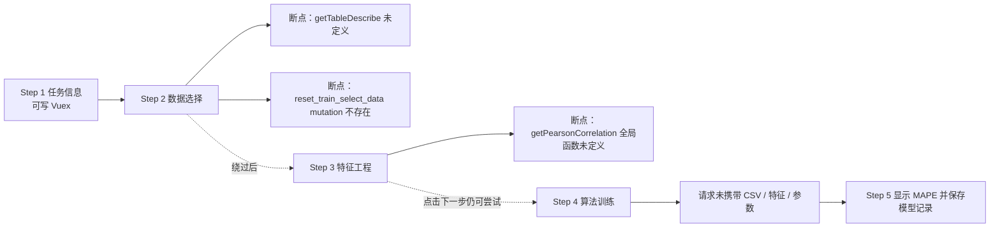

这条流程最能体现项目当前的架构：Vuex 跨步骤通信已经搭建，但数据链和算法链尚未完全接通。

---

## 从调用链看出的架构边界

本节仍是对当前源码的结构总结，不是优化方案。

### 1. 页面组件是主要业务编排者

请求前校验、请求参数组织、响应解析、状态更新和跳转通常都在同一个 `.vue` 的 method 中完成。`src/api/` 主要负责 URL 与 HTTP method，没有更深的领域模型或业务 service。

### 2. Vuex 不是全局业务数据中心

虽然项目安装了 Vuex，绝大多数页面仍使用本地 state。Vuex 真正承担的是模型训练五步之间的临时状态传递；根 data/task/model 列表没有在当前启动流程加载。

### 3. 后端也承担跨页面共享

模型保存后跳转 TaskManage，TaskManage 不读取 Vuex，而是重新请求 `/model/list`。历史参数保存与历史页面查看也通过后端衔接。这属于“后端持久化后再查询”的模块通信。

### 4. Props/Events 与 `$refs` 同时存在

`DebouncedSelect` 使用标准 Vue 2 v-model 协议；`Params` 虽使用 `$emit` 输出数据，但父组件不是等待用户输入事件自动同步，而是在提交时通过 `$refs` 命令式要求子组件 emit。组件通信既有声明式，也有命令式。

### 5. Vue 渲染与 ECharts 绘图是两套更新机制

普通表单、表格和结果区依靠响应式重渲染；ECharts 在 mounted 中直接操作 DOM。多数图表组件没有 props watcher 或销毁逻辑，因此不能假设父数据变化会自动更新已存在图表。

### 6. 身份数据可跨页，但不驱动统一鉴权

登录信息通过 sessionStorage 跨路由读取；Router meta、请求 token 和菜单权限没有形成统一链路。当前身份链的终点主要是页面显示和少量按钮条件，而不是全局导航/请求控制。

---

## 关键源码阅读索引

如果下一轮要验证上述调用链，建议按“链路”而不是按目录阅读：

| 调用链 | 阅读顺序 |
| --- | --- |
| 启动与页面装配 | `public/index.html` → `src/main.js` → `src/App.vue` → `src/router/index.js` → `src/components/sideBar/index.vue` |
| Store 更新与训练步骤替换 | `ModelTraining.vue` → 当前步骤组件 → `vuex_mixin.js` → `store/taskModule.js` → 回到 `ModelTraining.vue` 模板 |
| 业务 API 返回 | 页面 method → `src/api/*.js` → `src/utils/request.js` → 页面赋值语句 → 模板/computed |
| 算法 API 返回 | 参数调优/质量预测/AlgorithmSelect → `src/api/useAlgorithm.js` → `src/utils/requestAlg.js` → 页面 JSON 解析与状态更新 |
| 父子组件通信 | 参数调优/质量预测模板 → `DebouncedSelect.vue` 或 `Params.vue` → 父组件 handler |
| 登录到首页 | `Login.vue` → `utils/api.js` → `router/index.js` → `sideBar/index.vue` → `dash/index.vue` → 图表组件 |

## 结论

当用户在本项目中完成一次操作时，最常见的真实路径是：

```text
Element UI 事件
→ 当前页面 methods
→ 页面内校验与数据转换
→ API 薄封装
→ Axios 拦截器解包 response.data
→ 页面修改 data 或 commit Vuex
→ Vue 重新计算 computed 并 patch DOM
→ 必要时在 mounted 中由 ECharts 命令式绘图
```

只有模型训练采用较明显的跨组件 Vuex 状态机；其他核心流程基本是“页面本地状态 + 直接 API 调用”。当前最完整、最容易闭环追踪的链路是登录、首页统计、基础数据查询和 Excel 导出；参数推荐与质量预测已经到达算法服务，但界面输入到请求参数存在断流；模型训练则在第二、第三步存在明确运行期断点。
